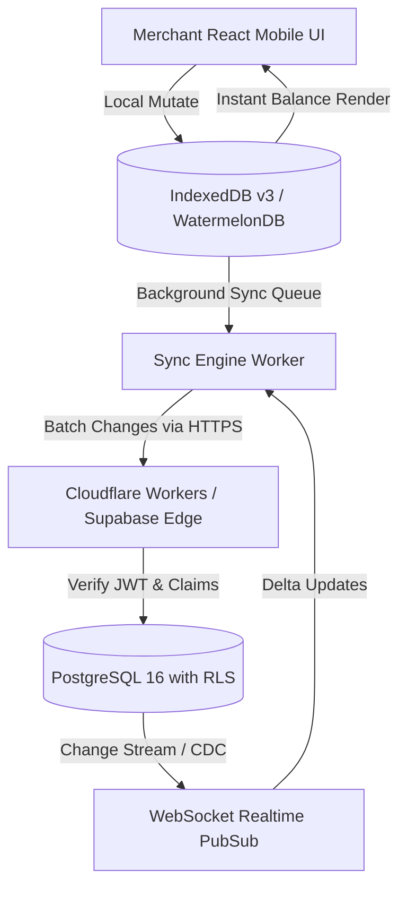

# HISAAB — Commercial Multi-Tenant Architecture & Security Specification

This architecture document outlines the commercial production blueprint for scaling **HISAAB** from the current browser-first local ledger to a distributed, multi-tenant cloud-synchronized SaaS supporting 500,000+ local retail businesses (kirana stores, provision stores, pharmacies) across India.

---

## 1. Multi-Tenant Architectural Principles

1. **Strict Tenant Isolation**: Each shop represents an isolated tenant (`tenant_id` / `shop_id`). Cross-tenant data leakage is prevented at the database kernel level using PostgreSQL Row-Level Security (RLS).
2. **Local-First & Offline Resilience**: Kirana stores often suffer from intermittent mobile network coverage (2G/3G drops, market basement dead zones). Every write action must succeed locally first in IndexedDB and synchronize asynchronously when network connectivity resumes.
3. **Zero Plaintext Sensitive Logging**: Customer mobile numbers, credit balances, and transaction notes are classified as Personally Identifiable Information (PII) under India's **Digital Personal Data Protection (DPDP) Act, 2023**.
4. **Lightweight Financial Invariants**: Ledger calculation follows immutable append-only accounting principles with derived point-in-time snapshots to ensure mathematical accuracy to the rupee ($₹$).

---

## 2. Authentication & Shop Identity Model

### Recommended Provider: Supabase Auth (or Firebase / Auth0)
- **Primary Shopkeeper Auth**: Phone OTP (via SMS/WhatsApp Provider like Twilio or Kaleyra) — essential for Indian retail merchants who do not regularly manage email passwords.
- **Biometric WebAuthn (Passkeys)**: FIDO2 biometric authentication (Fingerprint / Face Unlock) for 1-touch terminal unlocking.
- **JWT Claims**: The issued JWT contains claims:
  ```json
  {
    "sub": "user_89f023-...",
    "role": "authenticated",
    "app_metadata": {
      "active_shop_id": "shop_01hy7q8w9e",
      "shops": [
        { "shop_id": "shop_01hy7q8w9e", "role": "owner", "name": "Lakshmi Provision Store" },
        { "shop_id": "shop_02kz9x4a1b", "role": "manager", "name": "Ramesh General Store" }
      ]
    }
  }
  ```

---

## 3. Production PostgreSQL Schema with RLS

```sql
-- 1. Tenants (Shops)
CREATE TABLE shops (
    id UUID PRIMARY KEY DEFAULT gen_random_uuid(),
    owner_id UUID NOT NULL REFERENCES auth.users(id) ON DELETE RESTRICT,
    name VARCHAR(255) NOT NULL,
    upi_id VARCHAR(100),
    currency VARCHAR(10) DEFAULT 'INR',
    created_at TIMESTAMPTZ DEFAULT NOW(),
    updated_at TIMESTAMPTZ DEFAULT NOW()
);

-- 2. Shop Collaborators (Multi-User RBAC per Shop)
CREATE TABLE shop_members (
    id UUID PRIMARY KEY DEFAULT gen_random_uuid(),
    shop_id UUID NOT NULL REFERENCES shops(id) ON DELETE CASCADE,
    user_id UUID NOT NULL REFERENCES auth.users(id) ON DELETE CASCADE,
    role VARCHAR(50) NOT NULL CHECK (role IN ('owner', 'admin', 'clerk')),
    created_at TIMESTAMPTZ DEFAULT NOW(),
    UNIQUE(shop_id, user_id)
);

-- 3. Customers (Scoped to Shop)
CREATE TABLE customers (
    id UUID PRIMARY KEY DEFAULT gen_random_uuid(),
    shop_id UUID NOT NULL REFERENCES shops(id) ON DELETE CASCADE,
    name VARCHAR(255) NOT NULL,
    phone VARCHAR(15) NOT NULL,
    current_balance BIGINT DEFAULT 0, -- Stored in paise or rounded rupees
    total_credit BIGINT DEFAULT 0,
    total_payment BIGINT DEFAULT 0,
    last_credit_date DATE,
    last_payment_date DATE,
    created_at TIMESTAMPTZ DEFAULT NOW(),
    updated_at TIMESTAMPTZ DEFAULT NOW(),
    deleted_at TIMESTAMPTZ,
    UNIQUE(shop_id, phone)
);

-- 4. Transactions (Immutable Append-Only Ledger)
CREATE TABLE transactions (
    id UUID PRIMARY KEY DEFAULT gen_random_uuid(),
    shop_id UUID NOT NULL REFERENCES shops(id) ON DELETE CASCADE,
    customer_id UUID NOT NULL REFERENCES customers(id) ON DELETE RESTRICT,
    customer_phone VARCHAR(15) NOT NULL,
    type VARCHAR(20) NOT NULL CHECK (type IN ('credit', 'payment')),
    amount BIGINT NOT NULL CHECK (amount > 0),
    tx_date DATE NOT NULL,
    note TEXT,
    screenshot_url TEXT,
    created_by UUID REFERENCES auth.users(id),
    created_at TIMESTAMPTZ DEFAULT NOW(),
    client_tx_uuid UUID NOT NULL, -- Idempotency key for offline sync
    UNIQUE(shop_id, client_tx_uuid)
);

-- Indices for sub-millisecond querying
CREATE INDEX idx_customers_shop ON customers(shop_id) WHERE deleted_at IS NULL;
CREATE INDEX idx_customers_phone ON customers(shop_id, phone);
CREATE INDEX idx_tx_customer ON transactions(shop_id, customer_id, tx_date DESC);
CREATE INDEX idx_tx_date ON transactions(shop_id, tx_date DESC);
```

---

## 4. PostgreSQL Row-Level Security (RLS) Policies

Every query is automatically restricted to the shops where the authenticated user is an authorized member:

```sql
-- Enable RLS on all tenant tables
ALTER TABLE shops ENABLE ROW LEVEL SECURITY;
ALTER TABLE shop_members ENABLE ROW LEVEL SECURITY;
ALTER TABLE customers ENABLE ROW LEVEL SECURITY;
ALTER TABLE transactions ENABLE ROW LEVEL SECURITY;

-- Helper security function: Check user access to shop
CREATE OR REPLACE FUNCTION user_has_shop_access(target_shop_id UUID)
RETURNS BOOLEAN AS $$
BEGIN
    RETURN EXISTS (
        SELECT 1 FROM shop_members
        WHERE shop_members.shop_id = target_shop_id
          AND shop_members.user_id = auth.uid()
    );
END;
$$ LANGUAGE plpgsql SECURITY DEFINER;

-- 1. Customers RLS: Users can only see & modify customers belonging to authorized shops
CREATE POLICY customer_tenant_isolation ON customers
    FOR ALL
    USING (user_has_shop_access(shop_id))
    WITH CHECK (user_has_shop_access(shop_id));

-- 2. Transactions RLS: Strict shop scoping
CREATE POLICY transaction_tenant_isolation ON transactions
    FOR ALL
    USING (user_has_shop_access(shop_id))
    WITH CHECK (user_has_shop_access(shop_id));

-- 3. Shops RLS: Only members can view shop metadata
CREATE POLICY shop_member_view ON shops
    FOR SELECT
    USING (user_has_shop_access(id));
```

---

## 5. Offline-First Synchronization Architecture

To deliver an instantaneous $<16\text{ms}$ interface in low-connectivity retail environments:



### Sync & Conflict Resolution Rules
1. **Append-Only Idempotency**: Transactions carry a client-generated UUID (`client_tx_uuid`). If network drops and the client retries, the database ignores duplicates via `ON CONFLICT (shop_id, client_tx_uuid) DO NOTHING`.
2. **Customer Master Resolution**: "Last-Write-Wins" on metadata (e.g. name edits) using timestamp comparison.
3. **Ledger Integrity Invariant**: Balance is never directly modified without an underpinning transaction. A database trigger or background rollup recalculates customer running balances:
   $$\text{Balance} = \sum \text{Credits} - \sum \text{Payments}$$

---

## 6. Regulatory & Security Compliance (India DPDP Act 2023)

1. **Data Localization**: Database instances and object storage (for payment receipts) are hosted strictly in Google Cloud / AWS Mumbai (`ap-south-1`) or Hyderabad regions.
2. **Encryption Standards**:
   - **At Rest**: AES-256 for PostgreSQL tables and S3/GCS buckets.
   - **In Transit**: TLS 1.3 enforced for all API traffic.
   - **Application-Layer Tokenization**: Mobile numbers and customer identities can be pseudonymized in analytical audit logs.
3. **Data Erasure & Reset Compliance**:
   - When a merchant requests "Reset Local Ledger" or "Delete Shop Account", a soft-delete grace period with hard purge complies with Section 12 (Right to Erasure) of the DPDP Act.
   - In-app Reset Local Ledger purges local storage keys while leaving separate shop profiles and other shopkeepers' stores untouched.

---

## 7. Migration Path from Current Hackathon Edition

| Feature | Hackathon 10 Current Version | Commercial SaaS Target |
| :--- | :--- | :--- |
| **Storage Engine** | LocalStorage + IndexedDB v3 (browser-only) | SQLite/IndexedDB + Supabase PostgreSQL |
| **Multi-Tenancy** | Client-side `shopId` key & index isolation | PostgreSQL Row-Level Security (RLS) |
| **Auth** | No login (pure client-side) | Phone OTP + Biometric Passkeys (WebAuthn) |
| **Excel Export** | Client-side ExcelJS with master template | Serverless Edge worker + streaming ExcelJS |
| **Receipt Images** | IndexedDB Blob DataURL | Signed S3/GCS URLs with 30-day lifecycle |
| **WhatsApp Links** | Direct `wa.me/` URI scheme | WhatsApp Business API (WABA) Cloud API |
